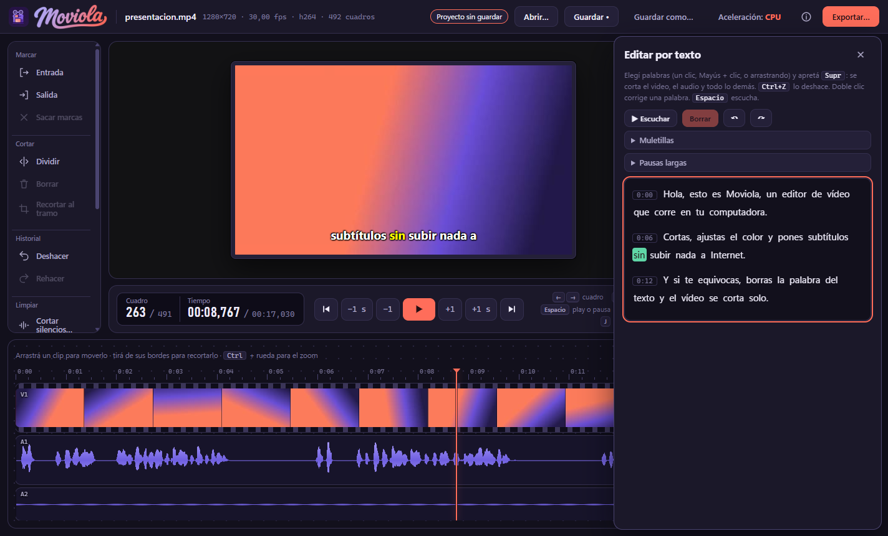

# Moviola

Local video and audio editor for Windows. Frame-accurate stepping (also for variable-frame-rate video), timeline editing with the mouse,
edit-by-text and karaoke subtitles (whisper.cpp), effects, transitions, batch presets and a command line, and export to MP4 / WebM / MOV /
MKV / GIF or audio only, in the original size, 9:16, 16:9 or 1:1. Everything runs on your machine: no accounts, no uploads.
Licensed under GPL-3.0-or-later. Documentation is in Spanish.



**Descargar:** el instalador para Windows 10/11 está en [Releases](../../releases/latest).

---

Editor de video y audio local para Windows. Ventana nativa, sin cuentas, sin nube: nada de lo que editás sale de tu computadora.
Versión 1.1.0. Software libre (GPL-3.0-or-later), sin ninguna garantía.

## Arrancar

Doble clic en `Moviola.bat`. Si algo falla y querés ver el error, usá `Moviola-consola.bat`,
que deja la consola abierta y enciende las herramientas de desarrollo del WebView.

Si en esa PC falta WebView2 (Windows 11 lo trae; algunos Windows 10 no), la app lo detecta y
abre sola en el navegador. También podés forzarlo con `Moviola-navegador.bat`. En ese modo, cerrar
la pestaña apaga el programa.

También podés pasarle un archivo: `python app.py "C:\ruta\al\video.mp4"`.

Si algo sale mal, quedan dos archivos al lado del programa: `editor.log` (avisos y errores
tecnicos, se recorta solo) y `ultimo-error.log` (si la app no pudo arrancar).

## Llevarlo a otra PC (versión portátil)

```
python construir_portatil.py
```

crea `dist\Moviola-portatil\` (unos 550 MB, casi todo FFmpeg): el programa, **su propio Python** aislado, `ffmpeg.exe` y `ffprobe.exe`, las licencias,
`LEEME.txt` (la guía corta para quien lo reciba) y los tres `.bat`. Se copia la carpeta entera a la otra PC (pendrive,
red, zip) y se hace doble clic en `Moviola.bat`: **no instala nada, no pide administrador, no usa internet**.

- **No descarga nada**: copia el Python con el que se desarrolla y las bibliotecas que la app realmente usa (las calcula
  a partir de lo que declaran `av`, `pillow` y `pywebview`), y el `ffmpeg.exe` y el `ffprobe.exe` que están en el PATH. La app
  usa los dos: `ffprobe` para sondear los archivos (proxy, miniaturas, audio).
- **Aislado**: el Python copiado trae `python313._pth`, así que ignora `PYTHONPATH`, el Python de la otra PC y sus
  paquetes. `pruebas/prueba_portatil.py` arma el paquete y lo hace abrir, preparar un proxy y exportar con `PYTHONPATH`
  envenenado y sin Python, ffmpeg ni ffprobe en el PATH. (Esa prueba encontró que la primera versión no llevaba
  `ffprobe.exe` y las miniaturas fallaban en silencio.)
- Si la carpeta es de solo lectura (Archivos de programa, un recurso de red), la app escribe sus ajustes, el registro y
  la caché en `%LOCALAPPDATA%\Moviola`.
- Pide Windows 10/11 de 64 bits. WebView2 viene con Windows 11; si falta, la app se abre sola en el navegador.
- **Licencias**: el paquete incluye FFmpeg compilado con x264 y x265 (GPL) y PyAV trae esas mismas bibliotecas. Se puede
  usar y compartir libremente, pero la carpeta `licencias\` tiene que viajar con el programa y quien lo reparta debe
  ofrecer el código fuente de FFmpeg (el enlace está en `licencias\LEEME-LICENCIAS.txt`). El código propio es software libre
  bajo GPL v3 o posterior (ver **Licencia** más abajo). El nombre "Moviola" quedó definitivo (decisión de Diego); es también el
  nombre histórico de las mesas de montaje de cine y consta como marca de EE. UU. en una clase de servicios de otro rubro, así
  que conviene una búsqueda formal en el INPI antes de venderlo o publicarlo con ese nombre (ver DECISIONES.md).
- **No se pudo probar en una PC realmente limpia** (no hay otra a mano): el aislamiento se verificó acá, no en un Windows
  sin Python ni ffmpeg. Conviene un arranque de prueba en la PC del trabajo antes de repartirlo.

## Instalarlo en otra PC (instalador)

```
python construir_instalador.py
```

crea `dist\Moviola-instalador\` y `dist\Moviola-instalador.zip` (≈ 560 MB): se lleva a otra PC con Windows 10/11 de 64 bits, se descomprime
**todo** y se hace doble clic en `Instalar-Moviola.bat`. Instala **sin permisos de administrador** (PowerShell 5, el que trae Windows) y, por
consola, todo lo que Moviola necesita:

| Qué | Dónde queda | De dónde sale |
|---|---|---|
| Moviola, con su Python, sus bibliotecas y FFmpeg | `%LOCALAPPDATA%\Programs\Moviola` | del propio paquete (no baja nada) |
| whisper.cpp (`whisper-cli`) | `%LOCALAPPDATA%\Programs\whisper.cpp` | GitHub, versión fija `b5454` (la probada), con su SHA-256 |
| un modelo de whisper a elegir (turbo, turbo comprimido, small, base) | `%USERPROFILE%\whisper-modelos` | Hugging Face, con su SHA-256 |
| yt-dlp | `<Moviola>\bin\yt-dlp.exe` | GitHub, la última, verificada con el `SHA2-256SUMS` de esa versión |
| WebView2 (la ventana) | del sistema | Microsoft, solo si Windows no lo trae |
| accesos (Inicio, Escritorio), «Aplicaciones instaladas», doble clic en `.moviola` | `HKCU` y carpetas del usuario | — |

- **Lo que ya está no se vuelve a bajar** (whisper en el PATH o en las carpetas de siempre, cualquier `ggml-*.bin`, yt-dlp de WinGet...).
  Si no hay internet se instala solo Moviola con FFmpeg, y se puede repetir después. Volver a ejecutarlo **actualiza** (conserva ajustes y caché).
- **Todo lo que se baja se verifica**: si la suma SHA-256 no coincide, no se instala. Las descargas las hace `curl.exe` (retoma si se corta).
- Sin preguntas: `Instalar-Moviola.bat -Silencioso` (modelo recomendado: el turbo comprimido, 574 MB) o `-Modelo small`, `-SinYtdlp`, `-SinWhisper`,
  `-SinWebView2`, `-SinAccesos`, `-SinEscritorio`, `-SinAsociar`, `-Destino`, `-Whisper`, `-Modelos`, `-Forzar` (todo esto está en `instalador\instalar.ps1`).
- **Desinstalar**: «Aplicaciones instaladas» de Windows, el acceso del menú Inicio, o `Desinstalar-Moviola.bat`. Solo borra una carpeta que tenga
  la marca `.moviola-instalado`; los videos y proyectos del usuario no se tocan; lo que se bajó aparte (whisper, modelo) se pregunta uno por uno.
- Los scripts se guardan como UTF-8 **con BOM** (PowerShell 5 lee un `.ps1` sin BOM como ANSI y rompe las tildes).
- El instalador no está firmado: Windows puede mostrar un aviso de SmartScreen. Es texto plano y se puede leer entero.

## Qué hace hoy

- Abre casi cualquier video y audio (probados 19 formatos de video y 9 de audio), con el botón
  o arrastrando el archivo (el arrastre real con el mouse no está verificado).
- Avance **cuadro por cuadro** exacto, también en video de framerate variable.
- **Espectro de audio** abajo, alineado con la tira de miniaturas.
- Reproducción con audio sincronizado. Lo que el navegador no reproduce (hevc, MPEG-2, 10 bits,
  mkv, AC3, ProRes, AV1...) se prepara solo en segundo plano con una copia liviana (**proxy**) y se
  ve una barra de progreso; mientras tanto se puede recorrer cuadro a cuadro.
- Modo solo audio (mp3, wav, flac...).
- **Aceleración por GPU** con un control CPU / GPU / Automático arriba a la derecha. La app prueba de
  verdad qué puede la PC, lo cuenta en castellano y avisa al abrir si hay algo que decidir.

- **Edición**: cortar (`S`), marcar un tramo (`I`/`O`) y borrarlo cerrando el hueco (`Supr`), recortar al tramo,
  deshacer y rehacer (`Ctrl+Z` / `Ctrl+Y`), fundidos de entrada y salida con curva y color, volumen, silenciar el
  audio del video, separarlo, y agregar audios extra (música, locución). Se elige un clip con un clic en la línea
  de tiempo. Funciona igual con archivos de solo audio.
- **Exportar** (botón *Exportar…* arriba a la derecha, o `Ctrl+E`): video original, vertical 9:16, horizontal 16:9 o
  cuadrado 1:1 (recortando o dejando barras, con la posición del recorte a elección), o solo el audio en WAV, MP3, FLAC
  o M4A; normalizar el volumen a −14 LUFS; carpeta y nombre a elección. Muestra el progreso, se puede cancelar sin
  dejar archivos a medias, y al terminar *Mostrar en la carpeta* abre el explorador con el archivo elegido. Nunca pisa
  un archivo: numera `nombre-v1`, `nombre-v2`...

- **Presets y lotes** («Reel en un clic»): el botón *Con un preset…* del riel (o *Procesar varios* en la pantalla de inicio) aplica una receta
  —cortar silencios, subtitular, nivelar el volumen, exportar— al proyecto abierto (sin tocarlo) o a muchos archivos de una vez. Recetas: `reel`
  (vertical con subtítulos), `youtube` (horizontal con `.srt`), `podcast` (MP3), `whatsapp` (liviano) y `clase`. Si falta whisper, el resto se hace igual.

- **Crear un proyecto**: en la pantalla de inicio, elegís varios videos y Moviola los pone uno detrás de otro en la línea de tiempo y te deja guardar el proyecto (`.moviola`).
- **Línea de tiempo con el mouse**: arrastrá un clip para ponerlo antes o después de otro; tirá de sus bordes para recortarlo (si sobra material de la
  fuente, también para estirarlo; lo que sigue se corre solo); arrastrá la música adonde quieras. `Ctrl` + rueda (o `+` / `−` / `0`) hace zoom; el imán pega los
  bordes al cursor, a las marcas y a los demás cortes (`Alt` lo apaga mientras arrastrás; `Esc` cancela). Todo se deshace con `Ctrl+Z`.
- **Editar por texto**: *Editar por texto…* abre un panel con lo que se dice, palabra por palabra. Elegís palabras y con `Supr` se corta el video, el audio y
  los subtítulos; `Ctrl+Z` lo deshace. También marca muletillas («eh», «o sea»), acorta pausas largas y corrige palabras (doble clic). Con el estilo
  de subtítulos *Resaltar la palabra que se dice* se obtiene el efecto karaoke. Necesita whisper instalado (ver Formatos y herramientas).

- **Acerca de**: el botón «i» del encabezado (o `F1`) muestra la versión, los autores, la licencia y qué herramientas (FFmpeg, whisper, yt-dlp) hay en esta computadora.

## Línea de comandos (`moviola.py`)

Lo mismo, sin ventana (en la versión portátil: `Moviola-comandos.bat`). Todo corre en tu PC, sin internet.

```
python moviola.py presets                                    # las recetas
python moviola.py procesar carpeta\ --preset reel -o listos\   # una carpeta entera (con -r entra a las subcarpetas)
python moviola.py procesar *.mp4 --preset youtube --sin-subtitulos --formato cuadrado
python moviola.py exportar proyecto.moviola --formato vertical --normalizar --subtitulos quemar,srt
python moviola.py silencios entrevista.mp4 --umbral -38 --minimo 0.8   # lista los silencios, no cambia nada
python moviola.py transcribir entrevista.mp4 --idioma es       # escribe .srt, .vtt y .txt
python moviola.py medir entrevista.mp4                          # LUFS, pico y rango
python moviola.py herramientas                                  # que hay instalado (ffmpeg, whisper, yt-dlp)
```

`--json` escribe el resultado como JSON en la salida estándar (el avance va a la de error). Códigos de salida: 0 todo bien, 1 algo falló
(en un lote, al menos un archivo; los demás se procesan igual), 2 pedido mal escrito, 130 cancelado con Ctrl+C. Sin `-o`, cada resultado va a una
carpeta `moviola-salida` al lado del original. Nunca pisa archivos (`-v1`, `-v2`...).

## Cómo está armado

```
app.py              arranca el servidor local y la ventana (o el navegador); la API del motor
motor/video.py      decoder PyAV persistente, indice real de cuadros, rotacion
motor/proxy.py      proxy de reproduccion: copia h264/aac liviana con la misma tabla de tiempos
motor/proyecto.py   modelo de edicion: pistas, clips, cortes, borrado con cierre, fundidos, deshacer
motor/exportar.py   exportador: 9:16 / 16:9 / 1:1 / original, audio solo, -14 LUFS, versionado
motor/lotes.py      presets y lotes: abrir, cortar silencios, subtitular, exportar, sin ventana
moviola.py          la linea de comandos (usa motor/lotes.py)
motor/gpu.py        deteccion REAL de aceleracion por GPU y politica CPU / GPU / Automatico
motor/audio.py      picos del waveform
web/edicion.js      la edicion en la interfaz: clips en los carriles, herramientas, inspector, vista previa
web/exportar.js     el dialogo Exportar: formato, encuadre, destino, progreso, cancelar, resultado
motor/tiras.py      tira de miniaturas de la timeline
motor/servidor.py   servidor HTTP local con token: interfaz, API, cuadros y medio (Range)
web/                interfaz: HTML, CSS y JS a mano, sin frameworks
pruebas/            pruebas automaticas (ver "Pruebas")
```

La interfaz y el motor hablan por **HTTP en 127.0.0.1**, no por el puente de pywebview. La
ventana nativa es solo un WebView apuntando a esa direccion, y la misma interfaz abre en cualquier
navegador.

Requisitos: Python 3.13, `pip install av pywebview`, y ffmpeg en el PATH.

## Pruebas

Todas corren con `python -I pruebas/<archivo>.py` y terminan en `TODO BIEN` o listan lo que falló.
Para aislarse usan dos variables de entorno: `EDITOR_AJUSTES` (otro archivo de ajustes) y `EDITOR_SIN_GPU=1`
(no correr la detección de GPU al crear la API).

| Archivo | Qué cubre |
|---|---|
| `prueba_video.py` | motor de cuadros: índice real (VFR), acceso aleatorio, MPEG-PS, rotación, concurrencia |
| `prueba_servidor.py` | seguridad del servidor: token, Host, Origin, rutas fuera de `web/`, Range, conexión reutilizada |
| `prueba_formatos.py` | 19 formatos de video, 9 de audio, carátula de mp3 y archivo truncado, por el camino completo |
| `prueba_app.py` | la app completa con **ventana real**: teclado, mouse, reproducir/pausar, CSP, latido |
| `prueba_navegador.py` | modo navegador: apagado al cerrar la pestaña, archivo inicial, diálogo |
| `prueba_proxy.py` | el proxy: misma tabla de tiempos que el original en 14 formatos, HDR, entrelazado, rotación, caché, cancelar |
| `prueba_proyecto.py` | el modelo de edición: casos concretos + **propiedades al azar** (4000 secuencias / 62.000 operaciones) |
| `prueba_exportar.py` | el exportador, verificado **cuadro por cuadro** con códigos de barras y por frecuencia de audio; incluye los dos videos reales |
| `prueba_edicion_api.py` | la API de edición por HTTP: operaciones, errores con el proyecto actual, audio extra, concurrencia |
| `prueba_edicion_app.py` | la edición con la **ventana real**: se lee el código de barras de lo que se ve en pantalla tras cortar y borrar |
| `prueba_exportar_api.py` | la exportación por HTTP: nombres, opciones inválidas, un trabajo a la vez, cancelar, editar mientras se exporta, GPU solo si se eligió |
| `prueba_exportar_app.py` | el diálogo **Exportar…** en la ventana real: se maneja con clics y teclas, y se lee el código de barras del archivo que sale |
| `prueba_portatil.py` | arma la **versión portátil** y la hace trabajar en un entorno hostil: su propio Python, sin ffmpeg ni ffprobe del sistema |
| `prueba_auditoria.py` | regresiones de la auditoría del código: NaN/Infinity rechazados, una sola exportación a la vez, archivo dañado no queda abierto |
| `prueba_efectos_app.py` | los efectos en la **ventana real**: agregar, ajustar (un cambio por vez), apagar, ordenar, quitar, deshacer y la vista previa en el visor |
| `prueba_audio.py` | los efectos de audio **medidos en el audio exportado** (nivel, frecuencia, picos, duración) y los silencios detectados y cortados, con el video exacto |
| `prueba_silencios_app.py` | el diálogo de silencios y la medición de volumen en la **ventana real** |
| `prueba_imagen.py` | los efectos de imagen **medidos en la imagen exportada** (color, curvas, LUT, ruido, enfoque, estabilizar con un marcador, rotar, recortar...) y las transiciones, con grises y tonos conocidos y con código de barras |
| `prueba_imagen_app.py` | los efectos de imagen y las transiciones en la **ventana real** |
| `prueba_descargas.py` | bajar de YouTube con un **yt-dlp de mentira** (sin internet): direcciones, que no se use nada para esquivar protecciones, errores en palabras claras, cancelar |
| `prueba_descargas_app.py` | el dialogo de YouTube en la **ventana real** (confirmar el derecho, errores, editar, sumar al proyecto, audio, cancelar) |
| `prueba_guardado.py` | guardar y abrir proyectos: ida y vuelta **exportando** (el archivo sale igual), archivos que faltan o se movieron, errores, recientes |
| `prueba_proyectos_app.py` | guardar, abrir, recientes, recuperación y el aviso de cambios sin guardar en la **ventana real** |
| `prueba_medios.py` | **tres videos distintos** en un proyecto: exportado medido (cada cuadro de su archivo, en orden, y el sonido), cuadros que pide el visor, reordenar, quitar, guardar/abrir, copia de reproducción de un MPEG-2 |
| `prueba_medios_app.py` | el panel de medios en la **ventana real**: el visor muestra el cuadro que corresponde de cada archivo (se lee el código de barras de lo que está en pantalla), la reproducción salta de un archivo a otro, las miniaturas, Orden |
| `prueba_salida.py` | los 7 tipos de archivo abiertos con ffprobe (contenedor, codec, pixel, sonido, 90 cuadros en orden), calidad medida con VMAF, GIF (tamano, cuadros, duracion), Opus y OGG |
| `prueba_salida_app.py` | el dialogo Exportar con los tipos, calidades y GIF en la **ventana real**, exportando de verdad |
| `prueba_subtitulos.py` | frases y estilo (modelo, 120 secuencias al azar), .srt/.vtt/.ass, el **texto quemado medido en la imagen exportada**, y la transcripcion real con whisper sobre una voz de Windows |
| `prueba_escenas.py` | cambios de escena, negros y congelados sobre un video de tramos conocidos, y en una linea de tiempo editada (cortes, velocidad, reversa) |
| `prueba_subtitulos_app.py` | subtitulos y escenas en la **ventana real** (transcribir, corregir, estilo, vista sobre el visor, exportar con subtitulos, cortar escenas) |
| `prueba_composicion.py` | logo, quitar fondo, texto y zoom lento: el **archivo exportado medido** (donde cae el logo en las 9 posiciones, color del fondo reemplazado, region y momento del texto, hacia donde se acerca el zoom) |
| `prueba_composicion_app.py` | los efectos de composicion en la **ventana real** (cuadro de texto, selector de imagenes) y exportados |
| `prueba_tiempo.py` | velocidad, cámara lenta, reversa, repetir y ducking: el modelo, 250 secuencias al azar y el **archivo exportado medido** (cuadros con código de barras, gris y tono de cada segundo, dB del ducking) |
| `prueba_tiempo_app.py` | velocidad, al revés, repetir y ducking en la **ventana real** |
| `prueba_gpu.py` | detección real, política CPU/GPU/Auto, decodificar por GPU, y el **respaldo** cuando un codificador falla |
| `prueba_gpu_app.py` | el control de aceleración en la **ventana real**: aviso, panel, cambio de modo, y de punta a punta con un NVENC que falla de verdad |
| `prueba_proxy_app.py` | el proxy en la **ventana real**: progreso, play antes de tiempo, pausa con el cuadro que coincide, cancelar, errores |
| `prueba_lotes.py`, `prueba_lotes_app.py` | presets («Reel en un clic»), lotes y la línea de comandos |
| `prueba_texto.py`, `prueba_texto_app.py` | editar por texto: palabras, pausas, muletillas, tiempos por palabra y karaoke |
| `prueba_linea_tiempo.py`, `prueba_linea_tiempo_app.py` | la línea de tiempo con el mouse: arrastrar, recortar bordes, zoom, imán |
| `prueba_dialogos.py`, `prueba_crear_proyecto_app.py`, `prueba_adaptable_app.py`, `prueba_acerca_app.py` | diálogos del sistema, «Crear un proyecto», la interfaz en distintas pantallas y «Acerca de» |
| `prueba_instalador.py` | el instalador y el desinstalador, sin internet y sin tocar el perfil del usuario |
| `prueba_revision.py` | regresiones de la revisión de la 1.1.0: programa plantado en la carpeta actual, proyecto con `NaN`, cerrar con trabajos en curso, ajustes que se pisaban, transcripción larga |

Las que usan dos videos reales del autor los buscan en la carpeta de la variable `MOVIOLA_VIDEOS_REALES` y, si no está, saltean esa parte. Con los dos reales
(un VFR de 15 min y un MPEG-2 entrelazado de 654 MB) se encontraron bugs que los clips
sintéticos no mostraban.

## Decisiones, y por qué

Todo lo que sigue está medido en esta máquina (Ryzen 5 5600GT, 32 GB, RX 6500 XT, NVMe),
con un clip de 60 s en 1080x1920 h264 a 30 fps. No son estimaciones.

### La GPU no se usa, a propósito

| Prueba | Resultado |
|---|---|
| `h264_amf` (codificar por GPU) | **falla**, error -22 |
| decodificar con `d3d11va` | 491 fps |
| decodificar por software (12 hilos) | **1196 fps** |

La RX 6500 XT no tiene motor de video: AMD le recortó el bloque VCN a ese modelo.
Y usar la GPU para decodificar es *más lento* que el software, porque copiar los cuadros
de la GPU a la CPU cuesta más de lo que ahorra. Todo el pipeline va por CPU, y sobra.

### Nunca un proceso ffmpeg por cuadro

Arrancar un proceso ffmpeg cuesta **70 ms**. Pedir un cuadro lanzando ffmpeg sale 230 ms,
que para arrastrar un cursor es inusable. Con PyAV y el decoder abierto en memoria:

| Operación | Medido |
|---|---|
| avanzar un cuadro (secuencial) | 0,84 ms |
| cuadro a JPEG 540x960 | 3,5 ms (32 KB) |
| cuadro a JPEG 270x480 | 1,1 ms (11 KB) |
| salto a un punto arbitrario (`seek`) | 134 ms (varía 49-212 según la distancia al keyframe) |

De ahí dos reglas en `motor/video.py`: el **seek inteligente** (si el cuadro pedido está
adelante y a 60 cuadros o menos, se decodifica secuencial en vez de hacer seek) y la **caché
LRU** de 120 cuadros. Medido: 4,1 ms por cuadro secuencial contra 134 ms por seek, y 0,016 ms
cuando el cuadro ya está en la caché.

Los 134 ms del seek no son overhead propio: con PyAV pelado, sin conversión a JPEG, los mismos
puntos dan 131,6 ms. Es el piso de lo que da PyAV en esta máquina. Por eso el frontend mantiene
**un solo pedido en vuelo** y descarta los viejos: si se disparan varios a puntos lejanos, se
encolan a 130 ms cada uno y la interfaz se siente pegajosa.

### `to_image()` sin reformatear antes cuesta 25 veces más

`frame.to_image()` convierte a RGB a resolución completa en Python: 22 ms.
`frame.reformat(width=W, height=H, format='rgb24')` hace lo mismo en C con swscale: 0,7 ms.
Siempre reformatear primero. El alto tiene que ser par o swscale falla.

### Por qué hay un servidor HTTP en una app local

Desde una página del WebView, el elemento `<video>` **rechaza** cualquier `file://`:

```
MEDIA_ELEMENT_ERROR: Media load rejected by URL safety check
```

Como la reproducción con audio sincronizado la queremos resolver con el `<video>` nativo (el
WebView sincroniza solo, y hacerlo a mano es el problema más caro de cualquier editor), hace falta
servirle el archivo por HTTP. Desde la etapa 2 ese mismo servidor sirve también **la interfaz, la
API y los cuadros**, y reemplaza al puente de pywebview. Ventajas: la misma interfaz corre en una
ventana nativa o en cualquier navegador (si falta WebView2), y los cuadros viajan como imagen
directa, no como base64.

Es lo único que queda escuchando en la máquina de otra persona, así que tiene defensas
(`motor/servidor.py`, probadas atacándolas en `prueba_servidor.py`):

- escucha **sólo** en `127.0.0.1`, con puerto efímero;
- un **token** aleatorio de 192 bits va en la ruta: sin él, todo da 404;
- valida `Host` (contra DNS rebinding), y en POST también `Origin` y `Content-Type: application/json`
  (un formulario o un `fetch` de otra página no pasa);
- sirve solo archivos de `web/` con extensión permitida y sin salirse de la carpeta;
- el medio abierto tiene su propio token, que cambia con cada archivo;
- la página lleva una política **CSP** que prohíbe cargar o enviar cualquier cosa fuera de este
  servidor. La garantía de "100% offline" la hace cumplir el navegador, y la prueba lo verifica
  intentando salir (queda bloqueado antes de tocar la red).

Nada sale de la máquina: loopback no toca la placa de red.

#### La conexión HTTP/1.1 se reutiliza: hay que leer SIEMPRE el cuerpo de un POST

Un bug real que solo apareció con un navegador de verdad: el servidor respondía `POST /api/latido`
sin leer su cuerpo de 2 bytes (`[]`). Esos bytes quedaban en la conexión y el pedido siguiente
llegaba como `[]GET /...`, que volvía con **501**. El `<video>` recibía un error, nunca pedía el
archivo, y mostraba "Format error", un mensaje que no apunta a la causa. Las pruebas no lo veían
porque abrían una conexión nueva por pedido. Regla: `_atender` consume el cuerpo de todo POST antes
de decidir nada, y la prueba `8b` mezcla pedidos en una sola conexión.

### Proxy de reproducción (`motor/proxy.py`)

El `<video>` del navegador solo reproduce h264 + aac en mp4 de 8 bits 4:2:0. Para todo lo demás
se genera un mp4 h264/aac de lado corto ≤ 720 (nunca agranda) y audio estéreo, en una carpeta
`cache/` junto al programa (tope de 5 GB, se limpia solo lo menos usado). Solo sirve para
ver y escuchar: el cuadro por cuadro, las miniaturas y el espectro siguen saliendo del original.

Lo que se aprendió al hacerlo, medido con los dos videos reales de Diego:

- **El proxy tiene que conservar la tabla de tiempos del original.** La interfaz calcula el cuadro
  de una pausa con la tabla del original. Si el proxy pasara un VFR a framerate fijo, la pausa
  mostraría otro cuadro. Por eso: `-fps_mode passthrough` (ni duplica ni descarta cuadros), base de
  tiempo fina (`-enc_time_base 1/90000`), y el desentrelazado es `yadif=mode=0` (un cuadro de salida por
  cada cuadro de entrada; con `mode=1` se duplicarían).
- **`-fflags +igndts` es imprescindible.** En un video real de 15 min (captura de pantalla / WhatsApp)
  el `pts` de cada cuadro va 1,25 s **adelantado** del `dts` del paquete. Apenas un cuadro trae el `pts`
  13 ms hacia atrás, ffmpeg concluye que los `pts` no son confiables y pasa a usar el `dts` **para todo
  el resto del archivo**: el proxy quedaba con 1,26 s de atraso (un desfase de sincronía real, no solo
  de tabla). Con `igndts` usa siempre el `pts`. Se vio con `ffprobe -show_frames`, comparando
  `pts_time`, `pkt_dts_time` y `best_effort_timestamp_time`.
- Algunos decoders entregan un cuadro con el tiempo hacia atrás; el codificador exige tiempos crecientes
  y se atasca (`dts` +1 tick por cuadro). El filtro `setpts` los fuerza a ser estrictamente crecientes
  con el mínimo desvío (13 ms en ese video).
- El HDR (`smpte2084`, `arib-std-b67`) se pasa a SDR con tonemap; sin eso sale lavado y gris.
- La rotación de celular queda aplicada (ffmpeg la aplica al transcodificar).
- **Validación del proxy:** `ffprobe` no detecta un archivo truncado, porque con `faststart` el índice
  está al principio y un proxy cortado a la mitad igual informa la duración completa. Por eso cada
  proxy lleva un archivo `.ok` con el tamaño final: sin él, o con otro tamaño, se regenera.
- En Windows, borrar un `.parcial` justo después de matar ffmpeg falla (sigue bloqueado un instante):
  `_borrar()` reintenta.
- Si se abre otro archivo mientras se prepara uno, el trabajo anterior se cancela; si dos pedidos piden
  el mismo archivo a la vez, se transcodifica una sola vez.

Tiempos medidos en esta máquina (Ryzen 5 5600GT, solo CPU): MPEG-2 1080i de 5 min 25 s en 43 s;
VFR de 15 min a 360×640 en 27 s.

### Aceleración por GPU (`motor/gpu.py`)

**No se fía de lo que dice ffmpeg.** `ffmpeg -encoders` y `-hwaccels` listan lo que la *build* soporta, no
lo que tiene la PC: en esta máquina, sin NVIDIA ni Intel, igual listan `nvenc` y `qsv`. Por eso cada
capacidad se **prueba de verdad**: se codifica 1 s con cada codificador y se decodifica un clip con cada
acelerador. Tarda ~11 s la primera vez; el resultado se guarda en `ajustes.json` y solo se repite si
cambia el equipo, el controlador o el ffmpeg (huella), o si la persona toca "Volver a comprobar".

Lo que se midió en la PC de desarrollo (Ryzen 5 5600GT + Radeon RX 6500 XT) y está en las pruebas:

- **Ningún codificador por hardware funciona** (nvenc/qsv/amf dan `-22`). La RX 6500 XT no trae el bloque
  de video de AMD.
- **`h264_mf` (Media Foundation) dice OK, pero es una mentira útil:** por defecto usa el codificador por
  **software** de Microsoft. Con `-hw_encoding 1` (obligar a hardware) falla con "could not find any MFT".
  Si se lo hubiera contado como GPU, la app habría prometido una aceleración que no existe. La detección lo
  prueba siempre con `-hw_encoding 1`.
- **Decodificar por GPU anda pero es entre 3 y 6 veces más lento** que el procesador en 1080p (d3d11va 4,1×,
  dxva2 5,7×, d3d12va 4,9× en h264). Por eso "Automático" no la usa acá.
- **PyAV informa `is_hwaccel = True` aunque caiga a software** (con MPEG-2 pidió GPU y el flag dice que sí,
  pero el cuadro sale `yuv420p` y no `nv12`). Para saber si realmente se usó la GPU se mira el formato del
  primer cuadro (`nv12`/`p010`). Es aproximado y está marcado así.
- **PyAV acepta cualquier nombre de acelerador sin quejarse y elige uno por su cuenta.** Se valida el nombre
  contra `hwdevices_available()` antes de usarlo.

**Política:** *CPU* siempre usa el procesador. *GPU* usa la GPU donde pueda (si se la pide sin que haya
codificador, cae al procesador y lo explica). *Automático* usa la GPU solo donde le gana al procesador (se
mide): codifica el proxy con GPU si hay, y decodifica con GPU solo si es más rápido. Por defecto: CPU.

**El respaldo es la garantía:** si un codificador de GPU falla, o produce tiempos que no coinciden con los del
original, el proxy se **repite con el procesador** y se le avisa a la persona. Nunca se queda sin reproducción
por culpa de la GPU. Esto SÍ está verificado de punta a punta, usando NVENC (que acá no existe y falla de verdad).

**Lo que NO se pudo verificar** (no hay el hardware): que un codificador NVENC / Quick Sync / AMF **que sí
funcione** produzca un proxy bueno. Los argumentos de cada uno (`_ARGS_CODIFICADOR` en `motor/gpu.py`) salen de la
documentación de ffmpeg y están sin probar en hardware real; ese camino se ejercitó con un codificador real
distinto de x264 (Media Foundation por software) puesto en su lugar. Tampoco hay medición de rendimiento de
ninguna GPU para codificar. Si en la PC del trabajo hay una NVIDIA o una Intel, es lo primero para probar.

**Gráficos integrados:** el procesador de esta PC trae gráficos AMD integrados que Windows no muestra, así que
probablemente están desactivados en la BIOS. La app lo dice como pista (no puede comprobarlo). Activarlos
podría habilitar la codificación por hardware. Es un cambio de BIOS y lo tiene que hacer la persona.

El cambio de modo se aplica al abrir el próximo archivo (no reabre el que está abierto).

### Modelo de edición (`motor/proyecto.py`)

Un `Proyecto` tiene **fuentes** (archivos), **pistas** (`V1` video, `A1` audio del video, `A2`... audio extra) y
**clips**: un tramo de una fuente (`desde`/`hasta`, en segundos de la fuente) puesto en la línea de tiempo (`inicio`).
Los clips del video y su audio comparten un **grupo** y se cortan y borran juntos. Es Python puro, sin ffmpeg ni
interfaz, para poder probarlo a fondo solo.

Garantías (todas verificadas, ver `pruebas/prueba_proyecto.py`):

- **Un corte cae siempre en un límite de cuadro real** de la fuente (el inicio de un cuadro o el final), también en
  video de framerate variable: se ajusta al más cercano. Nunca queda un cuadro partido.
- **Borrar un tramo lo saca de TODAS las pistas y cierra el hueco en todas a la vez.** Así la sincronía entre video y
  audio no se pierde, y un audio de fondo que cruzaba el tramo también se corta y se corre.
- **Cada operación es una transacción:** si falla, o explota a la mitad, el proyecto vuelve exacto a como estaba.
- **Deshacer y rehacer** (hasta 200) restauran el estado exacto; el historial guarda copias del estado, no operaciones
  inversas (más simple y a prueba de errores).
- Un fundido de entrada queda en la mitad izquierda de un corte y el de salida en la derecha; cada mitad acota los
  suyos a su largo nuevo.

Las pruebas incluyen **propiedades al azar**: miles de secuencias de operaciones donde, tras cada una, el proyecto
sigue válido, el video y el audio siguen sincronizados, V1 no tiene huecos, y deshacer todo vuelve al inicio. Esas
pruebas encontraron un bug real que las pruebas escritas a mano no veían: cortar un clip con un fundido de 8 s en un
punto temprano dejaba la mitad izquierda *más corta que su propio fundido*, un estado inválido.

Para la interfaz: tras un error el modelo restaura una **copia** del estado; no hay que guardar referencias a clips,
sino volver a leer el proyecto después de cada operación.

### El diálogo Exportar (`web/exportar.js` + `app.py`)

- **Se exporta una copia.** Al apretar *Exportar* el motor toma una copia de las pistas y trabaja en un hilo: si se
  sigue editando mientras tanto, el archivo no cambia (lo verifica `prueba_exportar_api.py`).
- **Un trabajo a la vez**, con progreso (se consulta cada 0,3 s) y cancelar. Cancelar borra lo que se había escrito.
- **Modo Automático = procesador.** Para el archivo final importa más la calidad que la velocidad: solo el modo *GPU*
  elegido a propósito usa el codificador de hardware, y si falla se exporta con el procesador y se avisa.
- **La interfaz no manda rutas para abrir.** *Mostrar en la carpeta* abre solo el último archivo que la app exportó;
  no acepta una ruta de afuera.
- El diálogo es un `<dialog>` modal: mientras está abierto ninguna tecla llega a los atajos del visor (Espacio no
  reproduce, `S` no corta, `Supr` no borra) y Esc no lo cierra si se está exportando. Si se abre otro archivo con el
  diálogo en el formulario, se cierra solo; una exportación en curso sigue.
- Clase CSS propia (`exp__op`): reusar `acel__op` rompía los botones del panel de aceleración, que recorre todos los
  `.acel__op` de la página.

### Efectos por clip (`motor/efectos.py`, `web/efectos.js`)

Un clip tiene una lista de efectos (`{id, tipo, activo, params}`). **El catálogo vive en un solo lugar**, `motor/efectos.py`: cada efecto
declara sus ajustes (rango, valor por defecto, unidad) y cómo se traduce a un filtro de ffmpeg. De ahí salen solos la validación, los
controles del panel de Propiedades (`efectos.js` no conoce ningún efecto) y el grafo del exportador. Para sumar un efecto: una entrada en `EFECTOS`
y su traducción. Hoy hay tres de ejemplo: **Brillo, contraste y saturación** (`eq`), **Voltear** (`hflip`/`vflip`) y **Quitar graves** (`highpass`).

- **Orden**: los efectos se aplican en el orden de la lista, después de encuadrar y escalar y antes de los fundidos; en audio, antes del volumen y los
  fundidos. Se pueden subir y bajar.
- **Un valor fuera de rango se rechaza**, no se recorta en silencio: si no, lo que se ve y lo que se exporta podrían no coincidir.
- **Al cortar un clip, cada mitad lleva su propia copia** de los efectos. El exportador solo une dos clips contiguos si sus efectos son iguales.
- **Vista previa**: los de video se ven en el visor con un filtro del navegador (aproximado); los de audio se oyen al exportar. Lo exportado es lo exacto,
  y se verificó midiendo la imagen y el audio del archivo que sale.
- No entran acá los efectos que cambian el tiempo (velocidad): rompen la cuenta de cuadros exacta y necesitan su propio diseño.

**Efectos de audio** (fase 2): Quitar graves, Quitar agudos, Graves y agudos, Quitar ruido de fondo, Quitar clics, Nivelar la voz, Compresor, Puerta de ruido,
Limitador, Eco, Cambiar el tono (sin cambiar la duración) y Al revés. Un clip de audio con efectos se fuerza a durar exactamente lo mismo (el eco y el tono agregan o
quitan milisegundos): si no, todo lo que viene después se correría y el audio se desfasaría del video.

**Efectos de imagen** (fase 3): Temperatura de color, Curvas de luz, LUT (archivo .cube/.3dl), Reducir ruido de imagen (rápido o fino), Enfocar o suavizar, Estabilizar, Rotar, Recortar bordes,
Corregir distorsión de lente y Enderezar el horizonte. Los que cambian el **tamaño** de la imagen (rotar, recortar bordes) se aplican **antes de encuadrar**, así que el formato de salida
(9:16, 16:9...) trabaja con la imagen ya girada o recortada. Una LUT o un análisis previo se llevan a una carpeta de trabajo temporal y el filtro usa solo su nombre (sin escapar rutas de Windows).
**Estabilizar** corre en **dos pasadas** (analiza el movimiento de la cámara y después lo compensa); en las pruebas el temblor de un marcador bajó de 25,8 a 0,0 px. No hay vista previa de estos efectos: se ven al exportar (cada tarjeta lo avisa).

### Bajar un video de YouTube (fase 8)

*Bajar de YouTube* (pantalla de inicio y panel de Medios): pegás la dirección de **un** video, elegís la calidad (o solo el audio en MP3), marcás que **tenés derecho a usarlo** (es tuyo, de libre difusión o con licencia que lo permita) y lo baja a `Videos\Moviola descargas`;
después lo editás o lo sumás al proyecto. Moviola **no esquiva ninguna protección** (sin cookies, sin cambio de país): si YouTube no deja bajar un video, te explica por qué. Usa el **yt-dlp que ya tengas instalado** (`winget install yt-dlp.yt-dlp`); Moviola no lo descarga por su cuenta.

### Proyectos y varios videos (fase 7)

- **Pantalla de inicio**: *Editar un video* o *Abrir un proyecto*, con la lista de lo abierto hace poco. Si la última vez se cerró con trabajo sin guardar, ofrece **Recuperarlo** (el programa va guardando una copia solo, un par de segundos después de cada cambio).
- **Guardar** (Ctrl+S) y **Guardar como…**: el proyecto es un archivo `.moviola` con todo lo editado (cortes, efectos, velocidad, subtítulos, música…). Cuando hay cambios sin guardar, el botón lo marca y antes de abrir otra cosa pregunta qué hacer.
  Si cuando lo abrís falta algún video, dice cuál; si moviste la carpeta entera (proyecto y videos juntos), los encuentra solo.
- **Panel Medios** (arriba, en la columna de la derecha): *Agregar videos…* los suma al proyecto (también podés soltarlos sobre el panel); cada uno tiene **Al final** y **En el cursor** (cae en el borde de clip más cercano y lo que sigue se corre), y se saca con la ✕ si no se usa.
  Los videos pueden ser de distinto tamaño y de distintos cuadros por segundo: el exportado toma el tamaño y los cuadros del primero. **Mover antes / Mover después** (sección *Orden* del clip elegido) cambia el orden. La vista previa salta de un archivo a otro con una pausita (al exportar no existe).
  Los subtítulos, los silencios y las escenas funcionan igual con varios videos.

### Tipos de archivo de salida (fase 6)

En *Exportar*, además de la forma de la imagen (original, vertical, horizontal, cuadrado), elegís el **tipo de archivo**: MP4 H.264 (el más compatible), MP4 H.265 (más chico), MP4 AV1 (el más chico, tarda más), WebM VP9 (para la web), MOV ProRes 422
(para seguir editando en otro programa), MKV H.264 y **GIF animado** (con ancho y cuadros por segundo; sin sonido, hasta 2 minutos). Salvo ProRes y GIF, elegís la **calidad** (alta, equilibrada o liviana). Para solo audio se suman **Opus** y **OGG**.
El H.265 puede usar la placa de video si la elegiste en la aceleración por GPU y esta la soporta; si no, usa el procesador.

### Subtítulos y escenas (fase 5)

- **Subtítulos…** (riel izquierdo, *Texto y escenas*): *Transcribir* escribe lo que se dice en la pista de voz (A1) **tal como quedó el montaje**, con el idioma que elijas y un máximo de letras por frase. Cada frase se corrige a mano (texto, inicio,
  final), se agregan o se quitan, y se elige cómo se ven (letra, tamaño, color, contorno, fondo oscuro, mayúsculas, posición). La frase actual se ve sobre el visor. Si después cambiás el montaje, avisa que pueden estar corridas.
- Al **exportar**, si hay frases aparecen las opciones *Quemarlos sobre el video*, *.srt* y *.vtt* (los archivos quedan al lado del video con el mismo nombre).
- La transcripción usa el **whisper que ya tengas instalado** (`whisper-cli` y un modelo `ggml-*.bin`, por ejemplo en `~/whisper-modelos`); Moviola **no descarga nada**. Si falta, el dialogo lo dice y podés escribir las frases a mano.
- **Escenas…**: busca cambios de escena, tramos negros y tramos congelados; podés cortar en cada cambio o sacar los tramos de una vez (un solo Deshacer).

### Composición: logo, fondo, texto y zoom (fase 4b)

Cuatro efectos nuevos en *Efectos de video* (se ven **al exportar**, la vista previa no los muestra):

- **Logo o imagen encima**: un `.png` (mejor con fondo transparente), `.jpg`, `.webp` o `.bmp` en una de 9 posiciones, con su tamaño (% del ancho), opacidad y margen.
- **Quitar el fondo verde o azul**: lo vuelve transparente y pone atrás un color (negro, blanco, gris) o una imagen.
- **Texto o título**: escribís el texto (puede tener varios renglones, acentos, comillas, lo que sea: se dibuja tal cual), elegís letra, tamaño, color, contorno, fondo oscuro, posición y entre qué segundos del clip se ve.
- **Zoom lento**: acercar o alejar de a poco durante el clip, hacia el centro que elijas.

### Velocidad, reversa, repetir y ducking (fase 4a)

- **Velocidad** (Propiedades > *Velocidad y tiempo*): de ¼× a 4×, del clip y de su audio enlazado. El audio **conserva el tono** (o suena "como una cinta" si se desmarca). A menos de 1× se puede pedir
  **cámara lenta suave** (se inventan los cuadros que faltan; tarda bastante más al exportar). Un clip dura `(tramo usado) ÷ velocidad` en la línea de tiempo y **todo lo que sigue se corre** en todas las pistas
  (si eso hiciera que dos músicas se pisen, avisa y no cambia nada). La vista previa la reproduce a su velocidad.
- **Al revés**: el clip y su audio de atrás para adelante. Se ve bien al exportar, pero la vista previa **no** lo reproduce (se recorre con las flechas). Un clip muy largo y pesado al revés se rechaza antes de empezar
  (guarda todos los cuadros en memoria).
- **Repetir este clip** de 2 a 20 veces; un solo Deshacer lo saca.
- **Música y voz (ducking)**: en una pista de música, *Bajar cuando habla el audio del video*: la música baja sola mientras suena la voz y vuelve cuando calla (3 a 24 dB). Se oye al exportar.
- La cantidad de cuadros de cada clip con otra velocidad se fija **exacta** sobre el tiempo acumulado, para que el video no se corra del audio.

### Transiciones (`motor/proyecto.py`, `motor/exportar.py`, `web/efectos.js`)

- Una **transición de entrada** por clip, entre dos clips pegados: disolvencia, fundido por negro o blanco, disolvencia granulada, deslizar, cortina, círculo, pixelar y acercarse. Se elige en
  Propiedades > *Transición de entrada* (aparece solo si el clip tiene otro pegado antes y sobra imagen y sonido a los lados del corte). Va en el video y en su audio enlazado (fundido cruzado).
- Está **centrada en el corte** y usa la mitad de su duración de la imagen y el sonido que **sobran** a cada lado (fuera del tramo que se usa): por eso **no cambia lo que dura el proyecto** y
  los cuadros fuera de la transición siguen exactos. La duración máxima sale de ese material sobrante (hasta 3 s).
- Una transición entre dos mitades de la **misma toma continua** no se nota (las dos muestran el mismo instante): sirve cuando se borró algo en el medio o cuando son tomas distintas.
- Reemplaza a los fundidos de sus bordes. Si después un corte o un borrado la deja sin clip pegado, o sin material, el motor la saca sola, dentro del mismo paso de deshacer.
- Se ve al exportar (la vista previa todavía no la muestra).

### Cortar silencios y medir el volumen (`motor/silencios.py`, `web/silencios.js`)

- **Cortar silencios…** (riel izquierdo, grupo *Limpiar*): se elige desde qué nivel es silencio, cuánto tiene que durar y cuánto margen dejar; *Buscar silencios* muestra
  cuántos hay, dónde, cuánto sumarían y cómo quedaría el proyecto, **sin cambiar nada**; *Cortar* los borra todos cerrando cada hueco en todas las pistas, así que el video,
  el audio y la música siguen sincronizados, y **un solo Deshacer los devuelve todos**.
- Se analiza el audio **original** de la pista A1 (una pasada de ffmpeg por archivo) y los silencios se llevan a la línea de tiempo clip por clip: sirve aunque ya se hayan
  hecho cortes. Un silencio que cruza un corte cuenta como uno solo. Se deja 0,1 s de margen a cada lado para no comerse el principio de una palabra.
- **Medir el volumen del proyecto** (Propiedades > Audio): LUFS, pico y rango de todo como queda al exportar (con efectos, volumen y fundidos), con una pista para redes (−14).
- Limitación: el análisis no se puede cancelar y en un archivo de horas tarda (decodifica el audio completo).

### Exportador (`motor/exportar.py`)

Formatos de video: `original`, `vertical` (1080×1920), `horizontal` (1920×1080), `cuadrado` (1080×1080), con
encuadre `recortar` (llena el cuadro, centrado o en un punto de foco) o `barras`. De audio: `wav`, `mp3`, `flac`,
`m4a`. Opcional: normalizar a -14 LUFS (dos pasadas). Nunca pisa un archivo: numera `-v1`, `-v2`...

Decisiones que importan para que el resultado sea **exacto**, no solo plausible:

- **Cada clip es una entrada propia con `-ss`/`-t`.** Cortar 10 s de un video de una hora no decodifica la hora
  (20 s de un video de 15 min se exportan en 2 s). Se afina con `trim` y media milésima de tolerancia para que ningún
  cuadro se pierda ni sobre por redondeo.
- **`-fflags +igndts` en cada entrada**, por lo mismo que en el proxy (ver arriba).
- **El cero de la línea de tiempo es el primer cuadro de la fuente**, no el inicio del contenedor (en el `.mpg` de
  Diego difieren 0,2 s). Se compensa al recortar; por eso `Video.info()` informa `inicio`.
- **El filtro se pasa por archivo (`-/filter_complex`).** Con cientos de cortes no entra en la línea de comandos de
  Windows (32.767 caracteres): se probó con 180 clips y un filtro de 41.617 caracteres. (En ffmpeg 9
  `-filter_complex_script` ya no existe.)
- **Salida siempre a framerate constante.** Un VFR se lleva a 24/25/30 según su promedio (el de Diego, 22,4 → 24).
- El audio se arma por pista: cada clip con su volumen y fundido (curva a elección), los huecos con silencio, y las
  pistas se mezclan con `amix` sin normalizar más un limitador. Las pistas silenciadas no entran; si no queda ninguna,
  el archivo no trae audio.
- Los clips seguidos que salen de la misma fuente sin interrupción se fusionan en uno solo.
- Las fuentes con pixeles no cuadrados, rotación de celular, entrelazado o HDR se corrigen al exportar, igual que en el
  proxy.
- Si un codificador de GPU falla, se repite con el procesador y se avisa con una frase clara (el volcado técnico de
  ffmpeg no se le muestra a la persona).

**Verificación (`pruebas/prueba_exportar.py`)**: las fuentes sintéticas llevan el número de cada cuadro escrito como
código de barras de 12 bits y un tono que sube 50 Hz por segundo. Se comprueba que los cuadros exportados son
*exactamente* los del proyecto, que el audio de cada instante sale del segundo correcto de la fuente (por frecuencia),
que los fundidos y el volumen dan lo medido, que el audio extra se mezcla entre los segundos correctos, y que en los
cuatro formatos y los dos encuadres el recuadro es el esperado (se lee el código a través del escalado y el recorte).
Con los videos reales: el VFR y el MPEG-2 entrelazado salen con la cantidad de cuadros correcta, alineados al original,
desentrelazados y con el 5.1 mezclado a estéreo.

**No verificado:** que el audio *suene* bien al oído (se mide por frecuencia y nivel, no se escucha); la calidad visual
del tonemap de HDR (solo se verifica que deje de ser HDR); un codificador de GPU que sí funcione (ver más arriba).

### Cómo está ordenada la interfaz (fase 0 del plan de `IDEAS.md`)

```
┌ barra superior: marca · nombre del archivo · [Abrir…] [Aceleración] [Exportar…] ┐
├ herramientas ┬ visor ──────────────────────────────┬ propiedades ┤
│ Marcar       │                                     │ del clip    │
│ Cortar       ├ transporte: contador · mandos ──────┤ elegido     │
│ Historial    │                                     │ (secciones) │
│ Audio        │                                     │             │
├──────────────┴─ línea de tiempo (lienzo con grilla de puntos) ───┴─────────────┤
```

- **Herramientas** (riel izquierdo): agrupadas por lo que hacen. Cada función nueva se suma a un grupo.
- **Propiedades** (panel derecho): muestra lo del clip elegido en secciones plegables (Fundidos, Audio, Clip). Es la base de las fases
  siguientes: cada efecto nuevo agrega una sección; una sección sin contenido para ese clip se oculta sola.
- **Línea de tiempo**: la película perforada es la firma de Moviola (solo la tira de video la lleva); al elegir un clip aparecen
  sus puertos, como en un editor de nodos. La grilla de puntos va en el marco y no en el contenedor de los carriles, para no mover el eje de tiempo.
- **Estilo**: violeta de noche con acento coral; tipografía del sistema (Segoe UI Variable) y DIN solo para los contadores. El texto sobre
  coral es oscuro a propósito (el blanco no llega a 3:1 de contraste). Todo en `web/estilo.css`, con los colores como variables en `:root`.
- Los avisos aparecen como tarjetas arriba al centro y no mueven el resto de la pantalla.

### La edición en la interfaz (`web/edicion.js` + el núcleo de `web/app.js`)

**Hay dos numeraciones de cuadros.** El cuadro de la *fuente* es el del archivo original (lo numera el motor). El cuadro
de la *línea de tiempo* es el de lo que se ve después de cortar. La interfaz trabaja con los de la línea de tiempo y, para
pedirle una imagen al motor, traduce con `fuenteDe(k)`. **Sin ediciones el mapeo es la identidad** (`L.tN` y `L.tT` son
`null`), por eso las suites anteriores a la edición siguieron valiendo sin tocarlas. Con ediciones, `reconstruirLinea()`
arma dos tablas (índice de cuadro de la fuente y segundo en la línea) a partir de los clips de `V1`.

**Reproducir con cortes.** El `<video>` reproduce el **archivo original**; la línea editada es una lista de tramos
(`S.segs`). Al llegar al final de un tramo se salta al principio del siguiente. Hay un instante de búsqueda en cada salto
(es la vista previa; el exportado no lo tiene).

**El proyecto vive en el motor.** La interfaz pide operaciones (`editar_dividir`, `editar_borrar_rango`...) y dibuja el
proyecto que vuelve. Tras un error el modelo restaura una copia, así que **nunca se guardan referencias a clips**: cada
respuesta, incluso la de un error, trae el proyecto completo (`prueba_edicion_api.py` lo verifica).

**Vista previa aproximada.** El fundido de video es una capa negra o blanca encima del visor; el fundido y el volumen del
audio se aplican al `<video>`; los audios extra suenan con elementos `<audio>` sincronizados al empezar. Es aproximado
(sobre todo el volumen por encima de 100 %, que el navegador no amplifica): **el resultado exportado es el exacto**.
Las curvas de fundido de la vista previa son una aproximación de las de ffmpeg.

Un bug real que se vio con los ojos y no con las pruebas: una clase CSS nueva (`.marca`) **pisó la del logo**
(`.marca`) y tapaba el borde izquierdo de toda la página. Se renombró `.marca-corte` y la prueba ahora verifica que el
logo no heredó estilos ajenos. Las clases nuevas conviene revisarlas contra las existentes.

**Todavía no (limites de esta entrega):**

- No hay **zoom** en la línea de tiempo: en un video largo los clips quedan chicos. Se corta con el cursor y los cuadros.
- No se **arrastran** clips ni sus bordes; se edita con dividir, marcar y borrar.
- No se puede **guardar ni abrir un proyecto** desde la interfaz (el motor sí: `Proyecto.guardar` y `cargar`).
- Varios archivos de **video** en la misma línea de tiempo: el modelo y el exportador lo soportan, pero la interfaz no lo
  ofrece todavía (solo audios extra).
- No se verificó **a oído** nada de la vista previa del audio.

### El visor usa dos fuentes distintas

- **Reproduciendo**: el `<video>` nativo, que sincroniza audio y video él solo.
- **Pausado**: el cuadro exacto que entrega `motor/video.py`, que permite el cuadro por cuadro.

Al pausar se calcula el cuadro con `Math.round(video.currentTime * fps)` y se cambia de uno
al otro sin salto visible.

### El bug del arranque silencioso (pythonw + start)

`Moviola.bat` lanza la app con `start "" pythonw app.py`. Eso **desacopla el proceso de la
consola**, y entonces `sys.stdout` y `sys.stderr` valen `None`. Cualquier linea que les hable
revienta antes de que se abra la ventana, y como no hay consola, **no queda ni rastro**: el
doble clic no hace nada y no hay error que leer.

Pasó de verdad: `app.py` empezaba con `sys.stdout.reconfigure(...)` y la app moria ahi. Lo
engañoso es que desde una terminal funcionaba perfecto, porque ahi si hay consola.

Dos defensas, las dos en `app.py`:

1. El `reconfigure` va dentro de un `if flujo is not None` con `try`.
2. Un `sys.excepthook` escribe cualquier excepcion no capturada en **`ultimo-error.log`**, al
   lado del `.py`. Si algun dia el doble clic no abre nada, ese archivo dice por que.
   `Moviola.bat` lo borra antes de arrancar, asi que si esta, es de esta corrida.

Regla para cualquier cosa que se agregue despues: **nunca asumir que hay stdout.**

## Formatos

9:16, 16:9 y 1:1. El visor se adapta al aspecto del material sin deformarlo ni recortarlo.

Si el archivo no es h264/aac en mp4 (por ejemplo hevc, prores o mkv), el WebView no lo puede
reproducir: `info()` devuelve `web_compatible: false` y la app avisa. El cuadro por cuadro, el
waveform y las miniaturas funcionan igual, porque esos pasan por PyAV y no por el `<video>`.

`web_compatible` exige además **4:2:0 de 8 bits**. Chromium, y por lo tanto WebView2, no
decodifica h264 High 10 ni 4:4:4: el `<video>` queda **negro** aunque el codec diga "h264".
Verificado con archivos reales de 10 bits y 4:4:4. El criterio es a propósito conservador,
porque equivocarse para un lado cuesta una pantalla negra y para el otro un proxy de más.

Detalle de PyAV 19 que cuesta una tarde si no se sabe: el transfer characteristic del stream se
llama **`color_trc` y es un entero** (16 = PQ, 18 = HLG), no `color_transfer` como lo nombra
ffprobe.

## Relación con el skill `editar-mis-reels`

El skill (en `~/.claude/skills/editar-mis-reels`) hace edición de reels por línea de comandos:
corta silencios, transcribe con whisper, pone subtítulos y arma. Este editor es una herramienta
aparte y más general. La idea es que más adelante compartan configuración: lo que se ajuste en
la app queda en `preferencias.md` del skill, así la app y la edición por chat respetan el mismo
gusto. Todavía no está conectado.

## Licencia

Moviola es software libre: **GNU General Public License v3 o posterior** (`GPL-3.0-or-later`). Autores: **Diego Bertelli** y
**Claude** (Anthropic, Claude Sonnet 5.5). El texto oficial está en [`LICENSE`](LICENSE) y las aclaraciones en castellano
(autoría con IA, qué cubre, marca, patentes, qué hacer si se reparte) en [`LICENCIA.md`](LICENCIA.md). Cada archivo de código lleva el
encabezado de copyright y el identificador SPDX. Para subirlo a GitHub hay una guía en [`GITHUB.md`](GITHUB.md).

## Más documentos

- `AUDITORIA-F8.md`: la auditoría profunda del código (qué se probó, qué se encontró, qué se arregló, qué no se pudo verificar).
- `PROPUESTAS.md`: mejoras posibles ordenadas por valor (backend, interfaz y funciones nuevas).
- `DECISIONES.md`, `ESTADO.md`, `CHANGELOG.md`, `IDEAS.md`: el porqué de cada decisión, el estado del trabajo, los cambios y las ideas.
