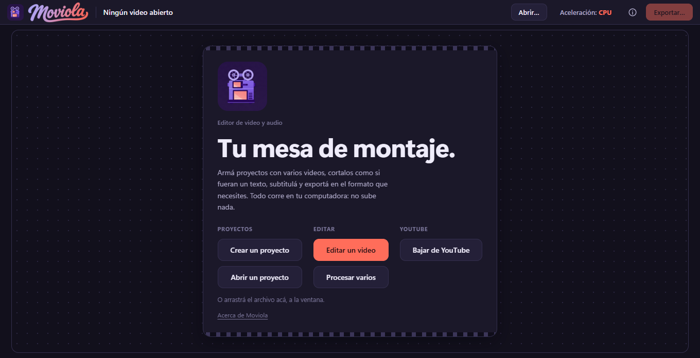
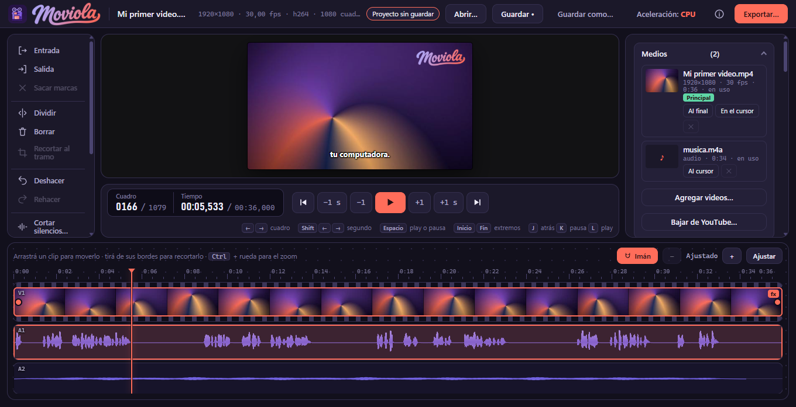
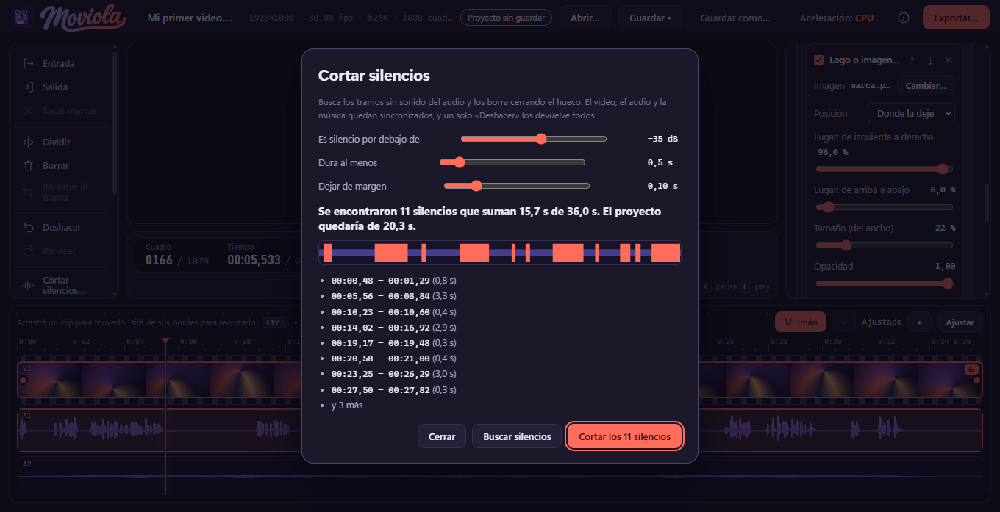
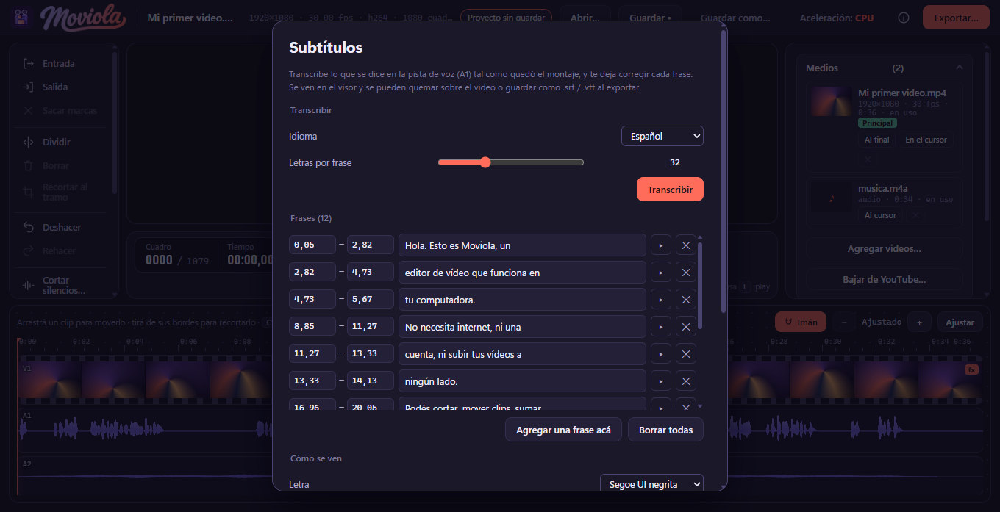
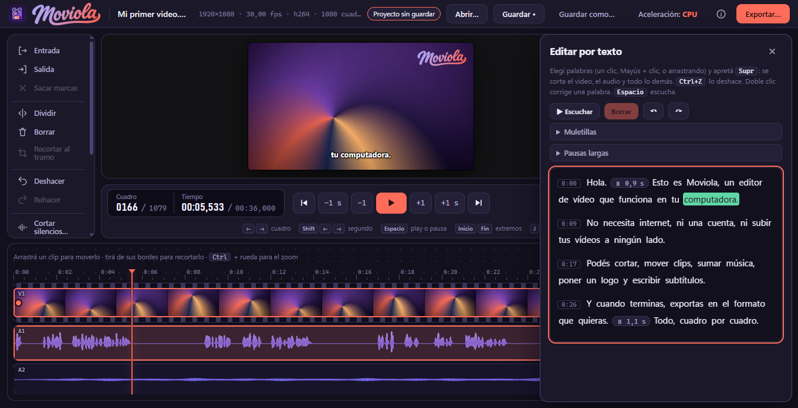
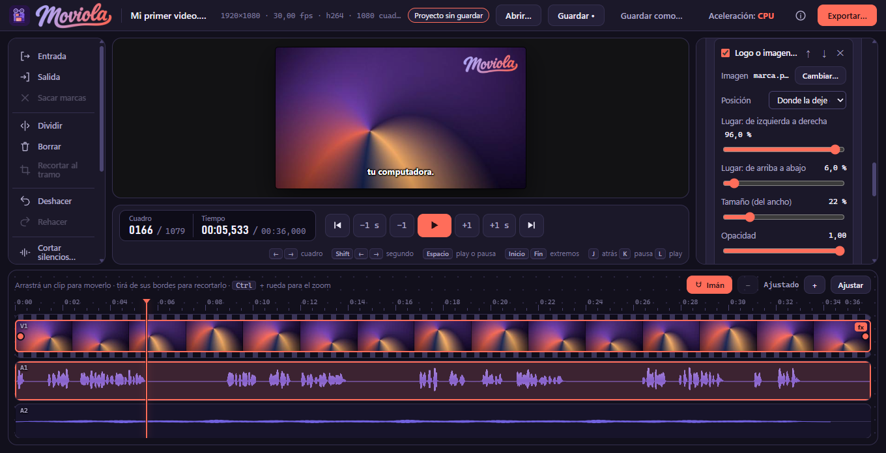
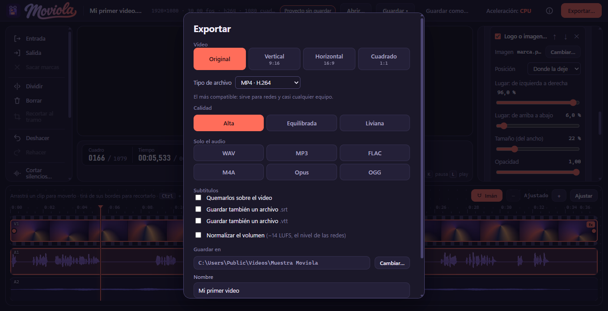
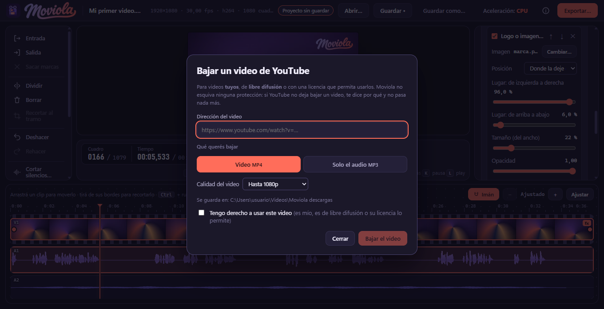

# Manual de Moviola

Moviola es un editor de video y audio que funciona **en tu computadora**: no necesita internet, no pide una cuenta y no sube tus
archivos a ningún lado. Con Moviola podés cortar, ordenar clips, sumar música, poner subtítulos, un logo o un título, y guardar el
resultado en el formato que necesites (para redes, para WhatsApp, para YouTube o para archivar).

Este manual va de lo básico a lo avanzado. No hace falta saber nada de edición: cada palabra técnica se explica la primera vez que
aparece.

> **Versión:** 1.2.0 · **Licencia:** GNU GPL v3 o posterior (software libre) · **Código:** https://github.com/diego-bertelli/moviola

---

## Índice

1. [Instalar Moviola](#1-instalar-moviola)
2. [La pantalla de inicio](#2-la-pantalla-de-inicio)
3. [La mesa de montaje: qué es cada parte](#3-la-mesa-de-montaje-qué-es-cada-parte)
4. [Moverse por el video](#4-moverse-por-el-video)
5. [Cortar y ordenar](#5-cortar-y-ordenar)
6. [Varios videos, música y audios extra](#6-varios-videos-música-y-audios-extra)
7. [Cortar los silencios de una vez](#7-cortar-los-silencios-de-una-vez)
8. [Subtítulos automáticos](#8-subtítulos-automáticos)
9. [Editar por texto](#9-editar-por-texto)
10. [Efectos: color, logo, texto y sonido](#10-efectos-color-logo-texto-y-sonido)
11. [Transiciones, velocidad y fundidos](#11-transiciones-velocidad-y-fundidos)
12. [Exportar: guardar el video terminado](#12-exportar-guardar-el-video-terminado)
13. [Proyectos: guardar el trabajo para seguir después](#13-proyectos-guardar-el-trabajo-para-seguir-después)
14. [Recetas («presets») y muchos videos a la vez](#14-recetas-presets-y-muchos-videos-a-la-vez)
15. [Bajar un video de YouTube](#15-bajar-un-video-de-youtube)
16. [Atajos de teclado](#16-atajos-de-teclado)
17. [Preguntas frecuentes y problemas](#17-preguntas-frecuentes-y-problemas)
18. [Palabras raras, explicadas](#18-palabras-raras-explicadas)

---

## 1. Instalar Moviola

Moviola funciona en **Windows 11** de 64 bits (Windows 10 debería andar, pero no se probó).

1. Entrá a la página de versiones: https://github.com/diego-bertelli/moviola/releases
2. Bajá el archivo `Moviola-1.2.0-instalador.zip` (pesa unos 220 MB).
3. Descomprimilo (botón derecho → *Extraer todo…*).
4. Hacé doble clic en **`Instalar-Moviola.bat`**.

Se abre una ventana negra (la «consola») que va contando lo que hace. **No pide permisos de administrador**: se instala solo para
tu usuario. Además de Moviola, ofrece bajar:

- **whisper**, el programa que escucha la voz y escribe los subtítulos, con un **modelo** (el «diccionario» que usa para
  reconocer palabras; los hay más chicos y rápidos o más grandes y precisos). Si ya lo tenías, lo reconoce y no lo baja de nuevo.
- **yt-dlp**, el programa que baja videos de YouTube.

Todo lo que baja lo comprueba con una **suma de verificación** (una huella del archivo) antes de usarlo. Al terminar quedan accesos en
el menú Inicio y en el escritorio, y los proyectos de Moviola (`.moviola`) se abren con doble clic.

**Actualizar:** se hace igual. El instalador nuevo reemplaza al viejo y conserva tus ajustes.

**Desinstalar:** desde *Configuración → Aplicaciones → Aplicaciones instaladas → Moviola*, o con `Desinstalar-Moviola.bat` dentro
de la carpeta del programa. Tus videos y proyectos no se tocan.

> Windows puede mostrar un aviso azul («Windows protegió su PC») porque el instalador no está firmado con un certificado pago. Si lo
> bajaste de la página oficial, tocá *Más información → Ejecutar de todas formas*.

---

## 2. La pantalla de inicio

- **Editar un video**: abrís un archivo y empezás a trabajar. También podés **arrastrar** el archivo a la ventana.
- **Crear un proyecto**: elegís varios videos y Moviola los pone uno detrás de otro.
- **Abrir un proyecto**: retomás un trabajo guardado (archivo `.moviola`).
- **Procesar varios**: le aplicás una receta a muchos videos de una vez (ver [capítulo 14](#14-recetas-presets-y-muchos-videos-a-la-vez)).
- **Bajar de YouTube**: ver [capítulo 15](#15-bajar-un-video-de-youtube).

Abajo aparecen los últimos proyectos que abriste. Si Moviola se cerró de golpe (un corte de luz, por ejemplo) con cambios sin guardar,
acá te ofrece **recuperarlos**.

Moviola abre casi cualquier formato: MP4, MOV, MKV, AVI, WebM, MPG y muchos más, y audios como MP3, WAV, FLAC u OGG.

---

## 3. La mesa de montaje: qué es cada parte

| Zona | Para qué sirve |
|---|---|
| **Arriba** | El nombre del archivo, sus datos (tamaño, cuadros por segundo, formato), *Guardar*, *Abrir* y **Exportar…** |
| **Izquierda: las herramientas** | Marcar entrada y salida, dividir, borrar, deshacer, cortar silencios, subtítulos, editar por texto, buscar escenas, recetas y agregar audio |
| **Centro: el visor** | Lo que se ve en el cuadro actual, con los efectos, el logo y los subtítulos aproximados |
| **Debajo del visor** | El número de **cuadro** y el **tiempo**, y los botones para avanzar y retroceder |
| **Derecha: Medios y Propiedades** | Los archivos del proyecto, y los ajustes del clip elegido (volumen, fundidos, efectos, transición, velocidad) |
| **Abajo: la línea de tiempo** | El montaje: cada pista es una fila. **V1** es el video, **A1** su sonido y **A2**, **A3**… la música o las voces que sumes |

La **línea roja** que cruza la línea de tiempo es el **cursor**: marca el instante que muestra el visor. Casi todo lo que hacés pasa
«en el cursor».

En la pista de audio se ve la **onda** del sonido: los picos altos son voz o ruido, las partes planas son silencio. Sirve para encontrar
dónde cortar sin escuchar todo.

> **Un video es una sucesión de fotos.** Cada foto se llama **cuadro** (o *frame*). Un video de «30 fps» muestra 30 cuadros por
> segundo. Moviola te deja ir cuadro por cuadro, así que podés cortar exactamente donde quieras.

---

## 4. Moverse por el video

- **Espacio**: reproducir o pausar.
- **← / →**: un cuadro atrás o adelante.
- **Shift + ← / →**: un segundo atrás o adelante.
- **Inicio / Fin**: ir al principio o al final.
- **J / K / L**: un segundo atrás, pausa, reproducir (como en los editores profesionales).
- **Un clic en la línea de tiempo** lleva el cursor ahí.
- **Ctrl + rueda del mouse** (o `+` / `−`) acerca o aleja la línea de tiempo para ver más detalle; `0` vuelve a mostrar todo.

Algunos formatos (por ejemplo, video de celulares nuevos en HEVC, o archivos de cámaras profesionales) no se pueden reproducir
directamente en la ventana. En ese caso Moviola prepara solo, en segundo plano, una **copia liviana** para mirar (se llama **proxy**) y
muestra una barra de avance. Mientras tanto podés recorrer el video cuadro por cuadro. El archivo exportado siempre sale del original,
no de la copia.

---

## 5. Cortar y ordenar

**Cortar en un punto:** llevá el cursor al lugar y tocá **Dividir** (o la tecla **S**). El clip queda partido en dos.

**Borrar un clip:** hacé clic en él (se marca en coral) y tocá **Borrar** (o **Supr**). El hueco se cierra solo: lo que sigue se corre
hacia la izquierda.

**Borrar un tramo:** marcá dónde empieza con **Entrada** (**I**) y dónde termina con **Salida** (**O**), y tocá **Borrar**. Para
quedarte solo con ese tramo y tirar el resto, usá **Recortar al tramo**. **Esc** saca las marcas.

**Con el mouse:**

- **Arrastrá un clip** para ponerlo antes o después de otro.
- **Tirá del borde** de un clip para acortarlo (o alargarlo, si el archivo original tiene más material).
- El **imán** pega los bordes al cursor, a las marcas y a los otros cortes, para que no queden huecos de un cuadro. Mantené **Alt**
  mientras arrastrás para soltarlo un momento. **Esc** cancela el arrastre.

**Deshacer y rehacer:** **Ctrl + Z** y **Ctrl + Y**. Funciona con todo, incluso con los cortes en grupo.

---

## 6. Varios videos, música y audios extra

**Sumar videos:** en el panel **Medios** (a la derecha), *Agregar videos…*, o arrastrá los archivos a ese panel. Cada video aparece
con sus botones **Al final** (lo pone al final del montaje) o **En el cursor** (lo mete donde está la línea roja).

**Sumar música o una voz:** con el botón de agregar audio de las herramientas. El audio va a una pista nueva (A2, A3…) desde el
cursor. Lo podés arrastrar adonde quieras.

**El volumen y los fundidos** de cada clip se ajustan en *Propiedades*. Un **fundido** es una entrada o salida gradual: el sonido sube
o baja de a poco, o la imagen aparece desde negro (o blanco).

**Que la música baje cuando alguien habla:** elegí un clip de la pista de música y activá *Bajar cuando habla el audio del video*. Esta
técnica se llama **ducking**: mientras suena la voz, la música baja; cuando la voz calla, vuelve.

---

## 7. Cortar los silencios de una vez

Ideal para clases, entrevistas o videos de redes: saca las pausas sin tener que buscarlas a mano.

1. Tocá **Cortar silencios…**
2. Ajustá:
   - **Es silencio por debajo de**: qué tan bajo tiene que ser el sonido para contar como silencio, en **dB** (decibeles: la medida
     del volumen; −35 dB es bastante bajo, −50 dB es casi nada).
   - **Dura al menos**: las pausas más cortas que esto se respetan (las pausas cortas son parte de hablar natural).
   - **Dejar de margen**: un poquito de aire antes y después de cada corte, para que no suene «mordido».
3. **Buscar silencios** te muestra cuántos encontró, cuánto suman y cómo quedaría el video, sin cambiar nada todavía.
4. **Cortar los silencios** los saca todos juntos. El video, el audio y la música quedan sincronizados, y un solo **Ctrl + Z** los
   devuelve.

---

## 8. Subtítulos automáticos

Moviola escucha la voz y escribe los subtítulos con **whisper**, un programa de reconocimiento de voz que corre **en tu
computadora**. Nada se manda a internet.

1. Tocá **Subtítulos…**
2. Elegí el **idioma** y cuántas **letras por frase** querés (menos letras = frases más cortas, mejor para celular).
3. Tocá **Transcribir**. La primera vez tarda un poco más porque carga el modelo. Se ve el avance.
4. Revisá la lista: cada frase tiene su tiempo de inicio y de fin. Corregí lo que haga falta, borrá con la ✕ o sumá una frase a mano
   en el cursor. El botón ▸ la reproduce.
5. Elegí **cómo se ven**: letra, tamaño, color, contorno negro, fondo oscuro, todo en mayúsculas, posición y distancia al borde.
   Con **Resaltar la palabra que se dice** se logra el efecto **karaoke**, muy usado en redes.

Los subtítulos se ven en el visor mientras editás. Al exportar podés **quemarlos** (quedan dibujados sobre la imagen, para redes) o
guardarlos aparte como archivo **.srt** o **.vtt** (el formato que aceptan YouTube y los reproductores, para activarlos o no).

Los subtítulos se transcriben de la pista **A1** (la voz del video), tal como quedó el montaje. Si después cortás algo, Moviola te avisa
que conviene transcribir de nuevo.

> Si el botón *Transcribir* aparece apagado, falta whisper. Instalalo de nuevo con el instalador (se ofrece solo) o sumá las frases a
> mano.

---

## 9. Editar por texto

Es la forma más rápida de editar una charla: el video se convierte en texto y **lo cortás borrando palabras**.

1. Tocá **Editar por texto…** (si todavía no hay transcripción, te ofrece hacerla).
2. Elegí palabras: un clic, **Shift + clic** para un tramo, o arrastrando.
3. Apretá **Supr**: se corta el video, el audio, la música y los subtítulos en ese lugar. **Ctrl + Z** lo deshace.

Además:

- **Muletillas**: encuentra los «eh», «mmm», «o sea», «bueno» o «digamos» y los podés borrar todos juntos.
- **Pausas largas**: las marcas ‖ con un número muestran cuánto dura cada silencio. Podés acortarlas todas de una vez.
- **Doble clic** en una palabra la corrige (cambia el subtítulo, no el audio).
- **Espacio** escucha desde la palabra elegida.

---

## 10. Efectos: color, logo, texto y sonido

Elegí un clip con un clic. En *Propiedades* aparecen **Efectos de video** y **Efectos de audio**: elegí uno de la lista y tocá
**Agregar**. Cada efecto tiene su tarjeta con controles; la casilla la prende o la apaga sin perder los valores, las flechas ↑ ↓
cambian el orden y la ✕ lo quita.

**De imagen:**

| Efecto | Qué hace |
|---|---|
| Brillo, contraste y saturación | Corrige la luz y el color (se ve en el visor mientras lo movés) |
| Temperatura de color | Más cálido (anaranjado) o más frío (azulado) |
| Curvas de luz | Aclara u oscurece las sombras y las luces por separado |
| LUT de color | Aplica un «look» de color guardado en un archivo `.cube` (los traen muchos paquetes de color) |
| Reducir ruido de imagen | Limpia el grano de las tomas con poca luz |
| Enfocar o suavizar | Marca más los detalles, o los suaviza |
| Estabilizar | Calma las sacudidas de una toma hecha a mano |
| Rotar, Voltear | Gira de a 90° o da vuelta como un espejo |
| Recortar bordes | Saca barras negras o algo que se coló en el borde |
| Corregir distorsión de lente | Endereza las líneas curvas de un gran angular |
| Enderezar el horizonte | Gira un poco la imagen y la amplía para que no queden esquinas negras |
| **Logo o imagen encima** | Pone un logo o una marca de agua (ver abajo) |
| Quitar el fondo verde o azul | La técnica de **pantalla verde** (*chroma key*): vuelve transparente el fondo y pone otro detrás |
| Texto o título | Escribe un texto sobre la imagen, con letra, color, posición y tramo |
| Zoom lento | Acerca o aleja la imagen de a poco, como en los documentales |

**Logo o imagen encima, paso a paso:**

1. Agregá el efecto y tocá **Elegir…** para buscar la imagen. Conviene un `.png` con **fondo transparente**: se ve solo el dibujo, sin
   recuadro.
2. **Ubicalo**: elegí una de las 9 posiciones de la lista, o **arrastrá el logo con el mouse en el visor** y soltalo donde quieras.
   Con el arrastre aparecen dos controles para afinar el lugar con números.
3. Ajustá el **tamaño** (en % del ancho del video), la **opacidad** (menos opacidad = marca de agua suave) y el **margen**.
4. Si querés que aparezca solo un rato, usá **Aparece a los** y **Desaparece a los** (en segundos desde el principio del clip; 0 = hasta
   el final). El botón **Usar donde está la línea roja** toma el tiempo del cursor.

**De sonido:** quitar graves o agudos, graves y agudos (como el control de tono de un equipo), quitar ruido de fondo, quitar clics,
nivelar la voz, compresor (achica la diferencia entre lo fuerte y lo suave), puerta de ruido (silencia lo que está por debajo de un
nivel), limitador (evita que sature), eco, cambiar el tono y al revés.

> La vista previa es **aproximada**: muestra el color básico, el volteo, el logo y los subtítulos. Los demás efectos se ven en el
> archivo exportado, que siempre es el resultado exacto. La tarjeta de cada efecto avisa cuándo es así.

---

## 11. Transiciones, velocidad y fundidos

**Transición:** elegí el clip que viene **después** de un corte. En *Transición* elegí el tipo (disolvencia, fundido por negro o por
blanco, deslizar, cortina, círculo, pixelar, acercarse…) y la duración. La transición se arma con un poquito de imagen que sobra a cada
lado del corte, así que **no cambia lo que dura el video**.

**Velocidad:** de ¼× (cuatro veces más lento) a 4× (cuatro veces más rápido). Opciones:

- **Mantener el tono del audio**: que la voz no suene como ardilla ni como monstruo.
- **Cámara lenta suave**: inventa los cuadros intermedios para que la cámara lenta no se vea a saltos (tarda más al exportar).
- **Al revés**: reproduce el clip de atrás para adelante.
- **Repetir este clip**: lo copia varias veces seguidas.

---

## 12. Exportar: guardar el video terminado

Editar en Moviola no cambia tus archivos originales: el resultado se arma recién al **exportar**. Tocá **Exportar…** (o **Ctrl + E**).

- **Video**: **Original** (como vino), **Vertical 9:16** (Reels, TikTok, historias), **Horizontal 16:9** (YouTube) o **Cuadrado 1:1**.
  Si el video no tiene esa forma, elegís si se **recorta** (y de qué lado) o si se dejan **barras**.
- **Tipo de archivo**: MP4 con H.264 es el más compatible (sirve para todo). También hay H.265 y AV1 (pesan menos, pero algunos equipos
  viejos no los abren), WebM, ProRes (para seguir editando en programas profesionales) y GIF (sin sonido, corto).
  El **códec** es la forma en que se comprime el video; el nombre del tipo de archivo te dice cuál usa.
- **Calidad**: Alta, Equilibrada o Liviana (menos calidad, archivo más chico: bueno para WhatsApp).
- **Solo el audio**: WAV, MP3, FLAC, M4A, Opus u OGG (para un podcast, por ejemplo).
- **Subtítulos**: quemarlos sobre el video y/o guardarlos como `.srt` o `.vtt`.
- **Normalizar el volumen**: lleva el volumen a **−14 LUFS**, el nivel que usan las redes y las plataformas (LUFS es una medida del
  volumen *percibido*, como lo oye una persona).
- **Guardar en** y **Nombre**: dónde y cómo se llama. Moviola **nunca pisa un archivo**: si ya existe, numera (`-v1`, `-v2`…).

Durante la exportación se ve el avance y se puede **cancelar** sin que quede un archivo a medias. Al terminar, **Mostrar en la carpeta**
abre el explorador con el archivo elegido.

**Aceleración (CPU / GPU):** arriba a la derecha dice qué usa Moviola para procesar. Algunas placas de video (**GPU**) codifican mucho
más rápido que el procesador (**CPU**). Moviola **prueba de verdad** qué puede hacer tu PC y te lo cuenta; si la GPU no sirve o es más
lenta, usa el procesador.

---

## 13. Proyectos: guardar el trabajo para seguir después

Un **proyecto** (archivo `.moviola`) guarda tus cortes, efectos, subtítulos y ajustes, **no los videos**: los videos quedan donde
estaban, y el proyecto los nombra. Por eso, si movés o borrás un video, el proyecto avisa que no lo encuentra.

- **Guardar** (**Ctrl + S**) y **Guardar como…** están arriba.
- Mientras trabajás, Moviola guarda una **copia de recuperación** cada tanto. Si se cierra de golpe, la pantalla de inicio te ofrece
  recuperarla.
- Si vas a abrir otra cosa con cambios sin guardar, te pregunta antes. El botón *Guardar •* (con el punto) indica que hay cambios
  sin guardar.

---

## 14. Recetas («presets») y muchos videos a la vez

Una **receta** hace varios pasos de una: cortar silencios, subtitular, nivelar el volumen y exportar.

| Receta | Para |
|---|---|
| Reel vertical | Vertical, con subtítulos quemados (Reels, TikTok, Shorts) |
| YouTube horizontal | Horizontal, con un archivo `.srt` aparte |
| Podcast | Solo audio en MP3 |
| WhatsApp liviano | Archivo chico, para mandar |
| Clase o charla | Horizontal, sin silencios largos y con subtítulos abajo: para material de formación |

- Con un video abierto: **Con un preset…** en las herramientas. Se aplica sobre una copia: tu proyecto no cambia.
- Con muchos videos: **Procesar varios** en la pantalla de inicio. Elegís los archivos y la receta, y Moviola los hace uno por uno.

---

## 15. Bajar un video de YouTube

Para videos **tuyos**, de **libre difusión** o con una licencia que permita usarlos. Moviola no esquiva ninguna protección: si YouTube
no deja bajar un video, te dice por qué y no pasa nada más.

1. **Bajar de YouTube** (en la pantalla de inicio o en el panel Medios).
2. Pegá la dirección del video.
3. Elegí **Video MP4** (con la calidad máxima) o **Solo el audio MP3**.
4. Marcá **Tengo derecho a usar este video** y tocá **Bajar el video**.

Se guarda en tu carpeta *Videos\Moviola descargas* y queda listo para editar o sumar al proyecto.

---

## 16. Atajos de teclado

| Tecla | Acción |
|---|---|
| Espacio | Reproducir / pausar |
| ← / → | Un cuadro atrás / adelante |
| Shift + ← / → | Un segundo atrás / adelante |
| Inicio / Fin | Principio / final |
| J / K / L | Un segundo atrás / pausa / reproducir |
| I / O | Marcar entrada / salida |
| Esc | Sacar las marcas (o cancelar un arrastre) |
| S | Dividir en el cursor |
| Supr | Borrar el clip elegido, el tramo marcado o las palabras elegidas |
| Ctrl + Z / Ctrl + Y | Deshacer / rehacer |
| Ctrl + S | Guardar el proyecto |
| Ctrl + E | Exportar |
| Ctrl + rueda, + / − / 0 | Zoom de la línea de tiempo |
| Alt (arrastrando) | Apagar el imán por un momento |
| F1 | Acerca de Moviola |

---

## 17. Preguntas frecuentes y problemas

**¿Moviola manda algo a internet?**
No. Todo se procesa en tu computadora. Solo se conecta si vos le pedís bajar un video de YouTube, y el instalador, para bajar whisper y
yt-dlp.

**¿Cuesta algo? ¿Tiene marca de agua?**
No y no. Es software libre (ver abajo).

**El video se ve pero no se puede reproducir.**
Es un formato que la ventana no reproduce directo. Esperá a que termine la barra *Preparando la reproducción*. Mientras tanto podés
moverte cuadro por cuadro.

**Un efecto no se ve en el visor.**
Algunos efectos solo se ven en el archivo exportado (la tarjeta lo avisa). Exportá con calidad *Liviana* para probar rápido.

**El botón Transcribir está apagado.**
Falta whisper o su modelo. Volvé a correr el instalador, que lo ofrece. El botón *i* (Acerca de) muestra qué herramientas encontró
Moviola en tu PC.

**Moviola se cerró de golpe.**
Al abrirlo de nuevo, la pantalla de inicio ofrece **Recuperarlo**. Si algo falla, Moviola deja un archivo `ultimo-error.log` con los
detalles: si nos lo mandás, nos ayuda a arreglarlo.

**Encontré un error o se me ocurrió una mejora.**
¡Contanos! En https://github.com/diego-bertelli/moviola/issues podés abrir un pedido (hace falta una cuenta gratis de GitHub).

---

## 18. Palabras raras, explicadas

| Palabra | Qué quiere decir |
|---|---|
| **Clip** | Un pedazo de video o de audio en la línea de tiempo |
| **Pista** | Una fila de la línea de tiempo (V1 = video, A1 = su sonido, A2… = audios extra) |
| **Cuadro / frame / fps** | Cada foto del video / cuántas fotos por segundo |
| **Códec** | La forma en que se comprime el video o el audio (H.264, H.265, AV1, AAC, MP3…) |
| **Exportar** | Armar el archivo final con todos los cambios |
| **Proxy** | Una copia liviana que se usa solo para mirar mientras editás |
| **dB (decibel)** | La unidad del volumen |
| **LUFS** | El volumen como lo percibe una persona; las redes piden −14 |
| **Ducking** | Bajar la música automáticamente cuando alguien habla |
| **Chroma key** | Quitar un fondo verde o azul y reemplazarlo |
| **LUT** | Un archivo con un «look» de color listo para aplicar |
| **Quemar subtítulos** | Dibujarlos sobre la imagen (no se pueden apagar) |
| **.srt / .vtt** | Archivos de subtítulos aparte, que se activan o no en el reproductor |
| **GPU / CPU** | La placa de video / el procesador |
| **whisper** | El programa libre que convierte la voz en texto |
| **FFmpeg** | El motor libre que lee, procesa y graba el video; Moviola está construido sobre él |

---

## Sobre Moviola

Moviola es **software libre** bajo la licencia **GNU GPL v3 o posterior**: lo podés usar para lo que quieras, ver cómo está hecho,
cambiarlo y compartirlo, siempre que lo que compartas siga siendo libre. Se distribuye **sin ninguna garantía**.

Lo hicieron Diego Bertelli y Claude (Anthropic). Por debajo trabajan otros programas libres: FFmpeg, PyAV, pywebview, Pillow, Python,
whisper.cpp y yt-dlp.
